# 🗺️ Master Workflow Architecture (Stack-Agnostic Edition)
**Platform:** Antigravity AI Agent
**Lokasi Skill:** `.agents/skills/<n>/SKILL.md`

---

## 📊 Diagram Alur Penuh

Ada dua jalur masuk. **Jalur A** untuk user yang sudah tahu stack. **Jalur B** untuk user yang baru punya
cerita/ide: PRD ditulis dulu, lalu stack direkomendasikan dari PRD.

```mermaid
flowchart TD
    Start["💡 Mulai Proyek Baru / Ide Baru"] --> Triage{"Pintu Masuk:\nSudah tahu stack\natau baru punya cerita?"}

    Triage -- "Jalur A: sudah tahu stack" --> P0A
    Triage -- "Jalur B: baru punya cerita" --> P1D

    subgraph PHASE0["⚙️ FASE 0 — Setup & Konvensi"]
        P0A["setup-project\nMode Mandiri\n• Wawancara stack, style, build flow, commit"]
        P0B["setup-project\nMode Rekomendasi\n• Baca PRD → usulkan stack + alasan awam\n• User approve / ganti"]
        P0_Human["🛑 HUMAN GATE:\nAgent beri command npm i / scaffolding\nManusia eksekusi di terminal"]
        P0A --> P0_Human
        P0B --> P0_Human
    end

    subgraph PHASE1["📋 FASE 1 — Spesifikasi (PRD)"]
        P1D["research-to-prd\n1. Terima cerita apa adanya\n2. Discovery (maks 6 pertanyaan, satu per satu)\n3. Ringkasan berbukti [Dari cerita] / [Asumsi]"]
        P1_Gate1{"Ringkasan\ndikonfirmasi?"}
        P1P["Draft PRD\n• Maks 4 User Story\n• Acceptance Criteria Given/When/Then\n• Open Questions"]
        P1_Gate2{"PRD\ndisetujui?"}
        P1D --> P1_Gate1
        P1_Gate1 -- "Revisi" --> P1D
        P1_Gate1 -- "Ya" --> P1P
        P1P --> P1_Gate2
        P1_Gate2 -- "Revisi" --> P1P
    end

    P0_Human -- "Jalur A" --> P1D
    P1_Gate2 -- "Jalur B: approve" --> P0B
    P1_Gate2 -- "Jalur A: approve" --> UICheck

    P0_Human -- "Jalur B" --> UICheck

    UICheck{"Produk punya\nantarmuka (UI)?"}

    subgraph PHASE1B["🎨 FASE 1b — Desain UI"]
        D1["prd-to-design\n• Daftar halaman + jejak US/AC\n• Rekomendasi preset per halaman\n• State: kosong/loading/error/sukses\n• Design system via ui-ux-pro-max (token, gaya, kontras)"]
        D_Gate{"Desain\ndisetujui?"}
        D1 --> D_Gate
        D_Gate -- "Revisi" --> D1
    end

    UICheck -- "Ya" --> D1
    UICheck -- "Tidak (API/CLI)" --> B0
    D_Gate -- "Approve" --> B0

    subgraph PHASE2["🔁 FASE 2 — Build Loop (Per User Story = Satu Branch)"]
        B0["create-feature-branch (Mulai)\n• Cek repo: ada commit pertama? tree bersih?\n• Nama branch dari fitur: feat/us-N-slug\n• git switch -c setelah approve"]
        B0_Ready{"Repo\nsiap?"}
        B0_Human["🛑 HUMAN GATE:\nCommit awal / rapikan\nperubahan lama (oleh manusia)"]
        B0_Gate{"Nama branch\ndisetujui?"}
        S1["code-development\n• Cek prasyarat: PRD, project-config, design + Master (jika UI)\n• Plan first"]
        S1_Gate{"Plan\ndisetujui?"}
        S1_Pkg{"Butuh package\nbaru?"}
        S1_Human["🛑 HUMAN GATE:\nnpm i &lt;pkg&gt; oleh manusia"]
        S1_Code["Implementasi + Explain-Back\n(fitur UI: pre-delivery checklist ui-ux-pro-max)"]
        S2["write-tests\n• Plan test per AC"]
        S2_Runner{"Test runner\nterpasang?"}
        S2_Human["🛑 HUMAN GATE:\nnpm i -D &lt;runner&gt; oleh manusia"]
        S2_Write["Tulis test (harus PASS)\nDilarang .skip"]
        S3{"Test\nlulus?"}
        S4["debug-fix\n• Perbaiki kode, bukan test"]
        S5["generate-commit\n• Susun pesan sesuai konvensi\n• Tunggu approve"]
        S5_Human["🛑 HUMAN GATE:\nManusia menjalankan\ngit add + git commit"]
        B1["create-feature-branch (Selesai)\n• Verifikasi tree bersih & test lulus\n• Siapkan perintah push + draf PR"]
        B1_Human["🛑 HUMAN GATE:\nManusia: git push → Pull Request → merge"]

        B0 --> B0_Ready
        B0_Ready -- "Belum" --> B0_Human --> B0
        B0_Ready -- "Siap" --> B0_Gate
        B0_Gate -- "Revisi nama" --> B0
        B0_Gate -- "Approve" --> S1
        S1 --> S1_Gate
        S1_Gate -- "Revisi" --> S1
        S1_Gate -- "Approve" --> S1_Pkg
        S1_Pkg -- "Ya" --> S1_Human --> S1_Code
        S1_Pkg -- "Tidak" --> S1_Code
        S1_Code --> S2 --> S2_Runner
        S2_Runner -- "Belum" --> S2_Human --> S2_Write
        S2_Runner -- "Sudah" --> S2_Write
        S2_Write --> S3
        S3 -- "Gagal" --> S4 --> S3
        S3 -- "Lulus" --> S5
        S5 --> S5_Human
        S5_Human -. "US belum selesai" .-> S1
        S5_Human -- "US selesai" --> B1 --> B1_Human
    end

    B1_Human -. "Masih ada US berikutnya\n(branch baru dari base terbaru)" .-> B0

    subgraph PHASE3["🔎 FASE 3 — Review & Dokumentasi"]
        R1["review-code\n• Report only\n• Pass 4 UI/UX jika diff menyentuh UI"]
        R2["generate-docs\n• Docstring & README"]
        EndApp["✅ Aplikasi Selesai"]
        R1 --> R2 --> EndApp
    end

    B1_Human -- "Semua US selesai" --> R1
```

---

## 🎨 Di Mana `ui-ux-pro-max` Dipakai

| Fase | Skill pemanggil | Peran |
|---|---|---|
| 1b | `prd-to-design` | Menurunkan design system; disetujui bersama halaman; disimpan ke `docs/design-system/<slug>/MASTER.md` |
| 2 | `code-development` | Kode memakai token; checklist sebelum serah terima; butir tak terverifikasi dilaporkan |
| 3 | `review-code` | Pass 4 UI/UX (report only) bila diff menyentuh UI |

Urutan prioritas bila ada pertentangan: **PRD > `docs/design.md` > Master > override halaman**.

---

## 🧭 Ringkasan Dua Jalur

| | Jalur A (sudah tahu stack) | Jalur B (baru punya cerita) |
|---|---|---|
| Urutan | 0 → 1 → 1b → 2 → 3 | **1 → 0 → 1b → 2 → 3** |
| `setup-project` | Mode Mandiri | Mode Rekomendasi (baca PRD) |
| Gaya komunikasi | Standar | Mode Pendamping (bahasa awam, perintah terminal dijelaskan) |

---

## 🌿 Satu User Story = Satu Branch

| Tahap | Siapa | Perintah |
|---|---|---|
| Buat branch `feat/us-N-slug` dari base terbaru | **Agent** (setelah `approve`, lokal saja) | `git switch -c <nama> <base>` |
| Commit | **Manusia** | `git add …` + `git commit …` (pesan disusun `generate-commit`) |
| Push | **Manusia** | `git push -u origin <nama>` |
| Pull Request & merge | **Manusia** | di GitHub/GitLab (draf judul/isi PR disiapkan agent) |
| Rapikan branch | **Manusia** | `git switch <base>` → `git pull` → `git branch -d <nama>` |

---

## 🛑 Aturan Mutlak: Human-Executed Installations & Git

Agent **DILARANG KERAS** menjalankan perintah instalasi package secara otomatis di terminal.

Setiap kali sebuah skill membutuhkan library baru, framework, atau test runner:
1. Agent **BERHENTI**.
2. Agent menampilkan blok perintah terminal secara terpisah.
3. Agent menjelaskan mengapa dibutuhkan, di mana menjalankannya, dan tanda berhasil.
4. Manusia mengeksekusi perintah secara manual.
5. Manusia membalas `"sudah"` atau `"lanjut"`, lalu agent melanjutkan.

Aturan yang sama berlaku untuk git: agent hanya membaca repository dan membuat branch lokal baru.
`git add`, `git commit`, `git push`, `git pull`, `git merge`, `git rebase`, `git reset`, dan penghapusan branch **hanya dilakukan manusia**.
