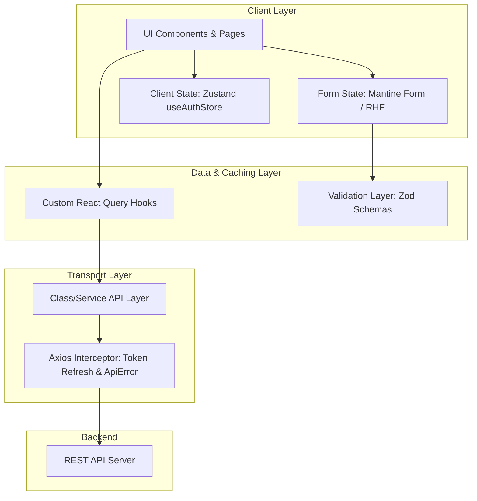

# Next.js Enterprise Frontend Architecture & Coding Style Template
*A production-ready blueprint & guidelines for scalable Next.js App Router applications.*

---

## 1. Ikhtisar & Arsitektur Utama (Tech Stack Matrix)

Template arsitektur ini disusun berdasarkan pola terbaik (*best practices*) dari proyek Popo Laundry, disempurnakan untuk menghindari *anti-pattern* dan siap diadopsi langsung pada proyek-proyek skala menengah hingga enterprise.



| Layer | Library / Teknologi | Tanggung Jawab Utama |
| :--- | :--- | :--- |
| **Framework** | Next.js (App Router) + TypeScript | Routing, SSR/SSG/ISR, layouting, server actions |
| **UI Components** | Mantine UI v9 + `@tabler/icons-react` | Primitif UI, modals, form inputs, notifications |
| **Styling** | Tailwind CSS + CSS Variables | Layouting cepat, design token brand, utilities |
| **Server State** | TanStack Query v5 (`@tanstack/react-query`) | Fetching, caching, invalidasi data server, optimistic updates |
| **Client State** | Zustand v5 | Sesi autentikasi global, state UI modal/drawer lintas halaman |
| **Form & Validasi** | Mantine Form / RHF + Zod | Validasi skema, parsing DTO, inline error reporting |
| **HTTP Transport** | Axios | Interceptor terpusat, rotasi refresh token otomatis, error unwrapping |
| **Maps / Visual** | Leaflet / React-Leaflet (`dynamic import`) | Peta interaktif & geolokasi tanpa kendala SSR |

---

## 2. Struktur Direktori Standar (Golden File Tree)

Gunakan struktur folder domain-driven berikut untuk menjaga skalabilitas proyek:

```
src/
├── app/                                # Next.js File-system Router
│   ├── (auth)/                         # Route Group: Autentikasi Pelanggan & Karyawan
│   │   ├── login/page.tsx
│   │   └── register/page.tsx
│   ├── (portal-customer)/              # Route Group: Modul Pelanggan
│   │   ├── layout.tsx                  # Customer Layout (AuthGateCustomer + Header + Footer)
│   │   ├── alamat/page.tsx
│   │   └── pesanan/
│   │       ├── page.tsx
│   │       └── [orderId]/page.tsx
│   ├── internal/                       # Route Group: Modul Back-Office & Lapangan
│   │   ├── (back-office)/
│   │   │   ├── layout.tsx              # Shell Navigasi Admin
│   │   │   ├── outlet-admin/
│   │   │   └── super-admin/
│   │   └── (field-ops)/
│   │       ├── driver/
│   │       └── worker/
│   ├── globals.css                     # Design tokens & CSS variables
│   ├── layout.tsx                      # Root HTML layout & Providers wrapper
│   └── page.tsx                        # Public landing page
├── components/                         # Komponen Reusable & Modul
│   ├── features/                       # Komponen spesifik fitur/domain bisnis
│   │   ├── auth/
│   │   ├── customer-orders/
│   │   ├── back-office-orders/
│   │   └── field-ops/
│   ├── shared/                         # Komponen struktural bersama (Header, Footer, Navbar)
│   └── ui/                             # Primitif UI generik (AsyncStateView, DataTable, Pagination)
├── hooks/                              # Custom React Hooks (React Query & Utilitas)
│   ├── auth/
│   ├── orders/
│   └── common/
├── lib/                                # Utilitas, Konfigurasi Inti & Helper
│   ├── api/                            # Axios client & Service classes
│   ├── auth/                           # Auth gates & permission guards
│   ├── constants/                      # Enums, static labels, routes
│   ├── theme/                          # Konfigurasi tema UI library
│   └── validation/                     # Skema Zod
├── middleware.ts                       # Next.js Edge Middleware (Auth & Redirect Guard)
├── providers/                          # React Context Providers wrapper
├── stores/                             # Zustand global stores
├── types/                              # Deklarasi TypeScript terpusat
│   ├── api/                            # DTO response/request backend
│   └── common.types.ts                 # Tipe generik (Pagination, Sorting)
└── utils/                              # Formatters (currency, date, strings)
```

---

## 3. Konvensi Penamaan (*Naming Conventions*)

Kerapian penamaan file mencegah terjadinya *build break* antar sistem operasi (Windows vs Linux CI/CD):

1. **Komponen React:** Menggunakan **PascalCase**  
   *Contoh:* `OrderBillSummaryCard.tsx`, `AsyncStateView.tsx`, `HeaderProfile.tsx`.
2. **Halaman & Layout Next.js:** Wajib lowercase standar Next.js  
   *Contoh:* `page.tsx`, `layout.tsx`, `loading.tsx`, `error.tsx`.
3. **Custom Hooks:** Menggunakan **camelCase** berawalan `use`  
   *Contoh:* `useOrderDetail.ts`, `useAddressLocationPreview.ts`.
4. **API Services & Validations:** Menggunakan pola `kebab-case.api.ts` atau `kebab-case.validation.ts`  
   *Contoh:* `order-customer.api.ts`, `address.validation.ts`.
5. **Tipe TypeScript:** Menggunakan `kebab-case.types.ts`  
   *Contoh:* `order-customer.types.ts`, `outlet.types.ts`.
   > [!WARNING]
   > Hindari menaruh dua file tipe dengan nama mirip seperti `order.types.ts` dan `orders.types.ts` di direktori yang sama. Berikan sufiks domain yang spesifik (misal: `order-customer.types.ts` vs `order-backoffice.types.ts`).
6. **No Trailing Whitespaces:** Dilarang menyisipkan spasi di akhir nama file maupun saat import.

---

## 4. Pola Tiga Lapis Manajemen State (*State Layering Rule*)

```
[ Data Server / Cache ]   ──> TanStack Query (useQuery, useMutation)
[ Sesi Global & Modal ]   ──> Zustand (useAuthStore)
[ Form & Validasi Form ]  ──> Mantine Form / RHF + Zod Resolver
[ State Lokal Komponen ]  ──> useState, useReducer
```

* **JANGAN** simpan data server (daftar pesanan, detail pengguna dari API, dsb.) di dalam Zustand atau Redux. Gunakan TanStack Query sebagai *single source of truth* data server.
* Gunakan Zustand hanya untuk informasi sesi yang bertahan di memori klien (misal: data ringkas user yang login, permission token, atau status sidebar).

---

## 5. Pola Standar Data Fetching & HTTP Layer

### A. Template Axios Singleton & Token Refresh Interceptor
Simpan di `src/lib/api/axios.ts`:

```typescript
import axios, { AxiosError, InternalAxiosRequestConfig } from "axios";

export const api = axios.create({
  baseURL: process.env.NEXT_PUBLIC_API_URL,
  withCredentials: true,
  headers: { "Content-Type": "application/json" },
});

export class ApiError extends Error {
  code: string;
  fields?: Record<string, string>;

  constructor(code: string, message: string, fields?: Record<string, string>) {
    super(message);
    this.name = "ApiError";
    this.code = code;
    this.fields = fields;
  }
}

type ErrorEnvelope = {
  success: false;
  error: { code: string; message: string; fields?: Record<string, string> };
};

type RetryableConfig = InternalAxiosRequestConfig & { _retry?: boolean };

let refreshPromise: Promise<void> | null = null;
const NO_REFRESH_ENDPOINTS = ["/auth/login", "/auth/register", "/auth/refresh"];

export async function refreshAccessToken(): Promise<void> {
  if (refreshPromise) return refreshPromise;

  refreshPromise = axios
    .post(`${process.env.NEXT_PUBLIC_API_URL}/auth/refresh`, {}, { withCredentials: true })
    .then(() => {})
    .finally(() => {
      refreshPromise = null;
    });

  return refreshPromise;
}

api.interceptors.response.use(
  (response) => response,
  async (error: AxiosError<ErrorEnvelope>) => {
    const originalRequest = error.config as RetryableConfig | undefined;
    if (!originalRequest) return Promise.reject(error);

    const isExcluded = NO_REFRESH_ENDPOINTS.some((url) => originalRequest.url?.includes(url));
    const code = error.response?.data?.error?.code;

    // Refresh hanya jika access token kedaluwarsa dan belum di-retry
    if (code === "ACCESS_TOKEN_EXPIRED" && !originalRequest._retry && !isExcluded) {
      originalRequest._retry = true;
      try {
        await refreshAccessToken();
        return api(originalRequest);
      } catch (refreshErr) {
        if (typeof window !== "undefined" && !window.location.pathname.startsWith("/login")) {
          window.location.href = "/login";
        }
        return Promise.reject(refreshErr);
      }
    }

    const payload = error.response?.data?.error;
    return Promise.reject(
      new ApiError(
        payload?.code ?? "UNKNOWN_ERROR",
        payload?.message ?? "Terjadi kesalahan. Silakan coba lagi.",
        payload?.fields
      )
    );
  }
);
```

### B. Template Service Class API
Simpan di `src/lib/api/order.api.ts`:

```typescript
import { api } from "./axios";
import type { ApiResponse, PaginatedResponse } from "@/types/api/common.types";
import type { OrderDetail, OrderListItem, OrderQuery } from "@/types/api/order.types";
import { buildQueryString } from "@/lib/query/buildQueryString";

export class OrderApi {
  async getOrders(params: OrderQuery): Promise<PaginatedResponse<OrderListItem>> {
    const qs = buildQueryString(params);
    const { data } = await api.get<ApiResponse<PaginatedResponse<OrderListItem>>>(`/orders?${qs}`);
    return data.data;
  }

  async getOrderDetail(orderId: string): Promise<OrderDetail> {
    const { data } = await api.get<ApiResponse<OrderDetail>>(`/orders/${orderId}`);
    return data.data;
  }

  async confirmOrder(orderId: string): Promise<{ message: string }> {
    const { data } = await api.post<ApiResponse<{ message: string }>>(`/orders/${orderId}/confirm`);
    return data.data;
  }
}

export const orderApi = new OrderApi();
```

### C. Template Custom Query Hook
Simpan di `src/hooks/orders/useOrder.hooks.ts`:

```typescript
import { useQuery, useMutation, useQueryClient } from "@tanstack/react-query";
import { orderApi } from "@/lib/api/order.api";
import { notifications } from "@mantine/notifications";
import type { OrderQuery } from "@/types/api/order.types";

export const ORDER_QUERY_KEYS = {
  all: ["orders"] as const,
  lists: () => [...ORDER_QUERY_KEYS.all, "list"] as const,
  list: (params: OrderQuery) => [...ORDER_QUERY_KEYS.lists(), params] as const,
  details: () => [...ORDER_QUERY_KEYS.all, "detail"] as const,
  detail: (id: string) => [...ORDER_QUERY_KEYS.details(), id] as const,
};

export function useOrders(params: OrderQuery) {
  return useQuery({
    queryKey: ORDER_QUERY_KEYS.list(params),
    queryFn: () => orderApi.getOrders(params),
    staleTime: 60 * 1000,
  });
}

export function useOrderDetail(orderId: string) {
  return useQuery({
    queryKey: ORDER_QUERY_KEYS.detail(orderId),
    queryFn: () => orderApi.getOrderDetail(orderId),
    enabled: Boolean(orderId),
  });
}

export function useConfirmOrder() {
  const queryClient = useQueryClient();

  return useMutation({
    mutationFn: (orderId: string) => orderApi.confirmOrder(orderId),
    onSuccess: (data, orderId) => {
      notifications.show({
        title: "Berhasil",
        message: data.message,
        color: "green",
      });
      // Invalidate cache query yang relevan
      queryClient.invalidateQueries({ queryKey: ORDER_QUERY_KEYS.detail(orderId) });
      queryClient.invalidateQueries({ queryKey: ORDER_QUERY_KEYS.lists() });
    },
    onError: (err: any) => {
      notifications.show({
        title: "Gagal",
        message: err.message ?? "Gagal memproses pesanan",
        color: "red",
      });
    },
  });
}
```

---

## 6. Primitif UI Reusable: Pola `AsyncStateView`

Pola ini mengeliminasi penulisan skeleton loader & alert error berulang di setiap halaman:

```typescript
// src/components/ui/AsyncStateView.tsx
"use client";

import { Skeleton, Stack } from "@mantine/core";
import type { ReactNode } from "react";
import { EmptyState } from "./EmptyState";
import { ErrorState } from "./ErrorState";

type AsyncStateViewProps<T> = {
  isLoading: boolean;
  isError: boolean;
  error?: unknown;
  data: T | undefined | null;
  onRetry?: () => void;
  isEmpty?: (data: T) => boolean;
  emptyTitle?: string;
  emptyDescription?: string;
  skeleton?: ReactNode;
  children: (data: T) => ReactNode;
};

export function AsyncStateView<T>({
  isLoading,
  isError,
  error,
  data,
  onRetry,
  isEmpty,
  emptyTitle = "Data tidak ditemukan",
  emptyDescription = "Belum ada data untuk ditampilkan saat ini.",
  skeleton,
  children,
}: AsyncStateViewProps<T>) {
  if (isLoading) {
    return skeleton ?? (
      <Stack gap="sm">
        <Skeleton height={24} width="40%" />
        <Skeleton height={40} />
        <Skeleton height={40} />
      </Stack>
    );
  }

  if (isError) {
    return (
      <ErrorState
        description={error instanceof Error ? error.message : "Terjadi kesalahan."}
        onRetry={onRetry}
      />
    );
  }

  const isDataEmpty =
    data == null || (isEmpty ? isEmpty(data) : Array.isArray(data) && data.length === 0);

  if (isDataEmpty) {
    return <EmptyState title={emptyTitle} description={emptyDescription} />;
  }

  return <>{children(data as T)}</>;
}
```

### Cara Penggunaan di Halaman:
```tsx
export default function OrderListPage() {
  const { data, isLoading, isError, error, refetch } = useOrders({ page: 1, pageSize: 10 });

  return (
    <AsyncStateView
      isLoading={isLoading}
      isError={isError}
      error={error}
      data={data?.data}
      onRetry={refetch}
      emptyTitle="Belum Ada Pesanan"
    >
      {(orders) => <OrderTable items={orders} />}
    </AsyncStateView>
  );
}
```

---

## 7. Pola Autentikasi & Role-Based Access Control (RBAC)

Kombinasi **Next.js Middleware (Edge Layer)** dan **AuthGate Component (Client Layer)** memberikan proteksi instan tanpa *flicker*:

### A. Next.js Edge Middleware (`middleware.ts`)
```typescript
import { NextResponse } from "next/server";
import type { NextRequest } from "next/request";

export function middleware(request: NextRequest) {
  const { pathname } = request.nextUrl;
  const token = request.cookies.get("accessToken")?.value;

  // Proteksi rute internal
  if (pathname.startsWith("/internal") && !pathname.startsWith("/internal/login")) {
    if (!token) {
      const url = new URL("/internal/login", request.url);
      url.searchParams.set("intended_url", pathname);
      return NextResponse.redirect(url);
    }
  }

  return NextResponse.next();
}

export const config = {
  matcher: ["/internal/:path*", "/pesanan/:path*", "/alamat/:path*"],
};
```

### B. Client Layout Gate (`AuthGateEmployee.tsx`)
```tsx
"use client";

import { useCurrentUser } from "@/hooks/auth/useCurrentUser";
import { Center, Loader } from "@mantine/core";
import { useRouter } from "next/navigation";
import { useEffect } from "react";
import type { Role } from "@/types/api/auth.types";

export function AuthGateEmployee({
  children,
  allowedRoles,
}: {
  children: React.ReactNode;
  allowedRoles: Role[];
}) {
  const router = useRouter();
  const { data: user, isLoading, isError } = useCurrentUser();

  useEffect(() => {
    if (isLoading) return;
    if (isError || !user) {
      router.replace("/internal/login");
      return;
    }
    if (!allowedRoles.includes(user.role)) {
      router.replace("/internal/forbidden");
      return;
    }
  }, [user, isLoading, isError, allowedRoles, router]);

  if (isLoading || !user || !allowedRoles.includes(user.role)) {
    return (
      <Center mih="100vh">
        <Loader size="md" />
      </Center>
    );
  }

  return <>{children}</>;
}
```

---

## 8. Pola Validasi Form & Zod Schema

Satukan definisi kontrak validasi formulir di folder `lib/validation/`:

```typescript
// src/lib/validation/address.validation.ts
import * as z from "zod";

export const addressSchema = z.object({
  recipientName: z.string().min(3, "Nama penerima minimal 3 karakter"),
  phone: z.string().regex(/^(\+62|62|0)8[1-9][0-9]{6,10}$/, "Format nomor telepon tidak valid"),
  provinceName: z.string().min(1, "Provinsi wajib dipilih"),
  cityName: z.string().min(1, "Kota/Kabupaten wajib dipilih"),
  districtName: z.string().min(1, "Kecamatan wajib dipilih"),
  streetDetail: z.string().min(10, "Alamat lengkap minimal 10 karakter"),
  latitude: z.number().optional(),
  longitude: z.number().optional(),
});

export type AddressFormValues = z.infer<typeof addressSchema>;
```

Hubungkan langsung dengan Mantine Form:
```tsx
import { useForm, schemaResolver } from "@mantine/form";
import { addressSchema, AddressFormValues } from "@/lib/validation/address.validation";

export function AddressForm() {
  const form = useForm<AddressFormValues>({
    initialValues: {
      recipientName: "",
      phone: "",
      provinceName: "",
      cityName: "",
      districtName: "",
      streetDetail: "",
    },
    validate: schemaResolver(addressSchema),
  });

  const handleSubmit = form.onSubmit((values) => {
    // values sudah terjamin type-safe dan tervalidasi
  });

  return (
    <form onSubmit={handleSubmit}>
      {/* input fields */}
    </form>
  );
}
```

---

## 9. Checklist Kesiapan Proyek Baru (*Production Checklist*)

Sebelum memulai proyek baru dengan template ini, pastikan:

- [ ] **Environment Sample:** Siapkan `.env.example` berisikan semua `NEXT_PUBLIC_*` variable.
- [ ] **Strict Routing Verification:** Periksa kembali `ROLE_HOME` agar mengarah ke route yang valid (`/` vs `/beranda`).
- [ ] **CSS Variable Naming:** Gunakan penamaan konsisten (misal: `--color-primary`, bukan singkatan `--c-primary`).
- [ ] **No Dead Code:** Hapus dependensi yang tidak terpakai dari `package.json` sebelum proses build.
- [ ] **Safe Dynamic Import:** Selalu gunakan `dynamic(() => import(...), { ssr: false })` untuk modul peta atau browser-only API.
- [ ] **Type Colocation:** Pisahkan nama tipe pelanggan dan back-office jika bentuk datanya berbeda.
- [ ] **Format Casing:** Komponen (PascalCase), Hooks (camelCase), Validations (kebab-case), Pages (Next.js convention).
